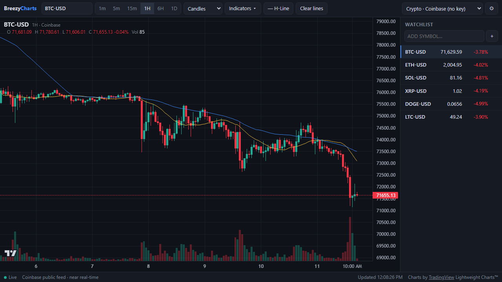

# BreezyCharts

A personal price-chart app in one static file, for use on your own computer. No build step, no server, no account: open `index.html` and it works.



## What it does

- **Crypto with no setup.** Coinbase's public feed, near real-time, no API key.
- **Stocks, ETFs and forex** through Twelve Data, using your own free API key.
- **Offline demo mode** with simulated prices, for trying things out.
- Candles, Heikin Ashi, bars, line and area charts, from 1 minute to 1 week.
- Indicators: SMA 20/50, EMA 200, Bollinger Bands, VWAP, volume, RSI and MACD.
- **Your own indicators.** Write them in a small formula language, with live preview and adjustable inputs.
- A watchlist per data source, with live prices and daily change.
- Horizontal lines you place by clicking the chart, saved per symbol.
- **Scroll back for more history.** Older bars load as you drag the chart to the left.
- **Links to charts.** The address bar always points at the chart you are looking at, so you can bookmark it.

## Using it

Download `index.html` and open it in a browser on your own computer. The whole app is that one file. It needs an internet connection to load the charting library and prices.

BreezyCharts is meant for personal use, run locally with your own data key. It is not meant to be published as a website for other people: the stock data comes under Twelve Data's terms, and its free plan is for personal use only.

Type anywhere to jump to the symbol box, then press Enter. Press Esc to cancel placing a line.

### Linking to a chart

The part of the address after `#` is `provider/SYMBOL/timeframe`:

| Link ending | Opens |
| --- | --- |
| `#coinbase/BTC-USD/1h` | Bitcoin, 1 hour, from Coinbase |
| `#twelvedata/AAPL/1D` | Apple, daily, from Twelve Data |
| `#demo/ACME/5m` | A simulated symbol, 5 minutes |

Providers are `coinbase`, `twelvedata` and `demo`. Timeframes are `1m`, `5m`, `15m`, `1h`, `4h`, `6h`, `1D` and `1W`, though each provider supports only some of them.

### Writing your own indicators

Open **Indicators**. Under **Scripts** you will find a few examples (MACD, Donchian channel, Keltner channel, SuperTrend, Stochastic) and **+ New script**. Tick a script to draw it, or press ✎ to edit it. The chart updates as you type, and mistakes are reported with their line number.

A script is a list of lines. Each line either names a value or calls a function:

```
length = input(20, "Length", min=1)       // a number you can change below the editor
mult   = input(2, "Width", step=0.1)

mid   = sma(close, length)
upper = mid + mult * stdev(close, length)
lower = mid - mult * stdev(close, length)

plot(mid, "Mid", color=orange)
plot(upper, "Upper", color=teal)
plot(lower, "Lower", color=teal)
plot(crossover(close, upper) ? high : na, "Breakout", color=green, style=dots)
```

The rules:

- `open`, `high`, `low`, `close`, `volume`, `hl2`, `hlc3`, `ohlc4`, `tr`, `vwap`, `time` and `bar_index` are series with one value per bar. Arithmetic and comparisons work on whole series at once.
- `x[1]` is the value of `x` one bar ago.
- `a ? b : c` picks `b` where `a` is true and `c` elsewhere. Combine conditions with `and`, `or` and `not`.
- `na` means "no value". A plot leaves a gap wherever its value is `na`.
- `//` starts a comment.

To draw, use `plot(value, title, color=, width=, style=, pane=)` and `hline(value)`:

- `style` is `line`, `dashed`, `dotted`, `dots`, `histogram` or `area`.
- `pane` is `main` (on the price chart, the default) or `below` (the script's own pane under it). Give it on every plot that belongs below: a plot without it goes on the price chart, even right after a plot that is below. `hline` is different, and goes in the same pane as the plot before it unless you say otherwise.
- `color` is a name such as `red`, a code such as `"#ff8800"`, or a choice per bar such as `x > 0 ? green : red`.

The functions:

| Group | Functions |
| --- | --- |
| Averages | `sma`, `ema`, `rma`, `wma` |
| Windows | `sum`, `highest`, `lowest`, `stdev`, `linreg`, `cum` |
| Momentum | `change`, `roc`, `rsi`, `stoch` |
| Trend and volatility | `atr`, `supertrend`, `sar` |
| Signals | `crossover`, `crossunder`, `cross`, `barssince`, `valuewhen` |
| Maths | `abs`, `sqrt`, `log`, `exp`, `round`, `floor`, `ceil`, `sign`, `pow`, `max`, `min`, `avg`, `nz`, `na` |

The **Reference** section at the bottom of the editor lists each one with what it takes.

There are no loops and no variables that carry over from bar to bar, so a script cannot hang the page. Indicators that need those, such as SuperTrend and Parabolic SAR, are provided as functions. Scripts are saved in your browser; to move one to another browser, copy its text.

The language is its own script block in `index.html` (`<script id="formula">`). It has no dependencies and also runs under Node once taken out of the page; the top of `tests/formula.test.js` shows how.

### Stock data

Stocks need a free Twelve Data key:

1. Register at [twelvedata.com/register](https://twelvedata.com/register). No card is needed.
2. In BreezyCharts, open ⚙ Settings and paste the key.

The free plan covers US markets and is for personal use only. Use your own key, on your own computer, and do not put the charts or prices where other people can see them. Twelve Data's terms say what your plan allows.

#### Credits

Twelve Data counts usage in credits, and the free plan allows 8 a minute and 800 a day. BreezyCharts spends them like this:

| Action | Credits |
| --- | --- |
| Loading a chart (opening a symbol, changing the timeframe) | 1 |
| Refreshing the open chart, once a minute | 1 |
| Loading older bars when you scroll back | 1 per page of 500 bars |
| Watchlist quotes, once a minute | 1 per symbol, 3 symbols per round |

BreezyCharts paces its own requests so it stays inside the per-minute limit:

- **Background use is 4 credits a minute**: 1 for the chart and 3 for the watchlist. The other 4 are there for your clicks.
- **The watchlist rotates.** Each round quotes the three symbols whose prices are oldest, so a six-symbol list is fully refreshed about every two minutes, and a longer list takes proportionally longer.
- **Your clicks come first.** Every request goes through one queue. A chart you asked for (a symbol, a timeframe) is served before anything else and may use any free credit. The minute refresh and older bars come next and always leave one credit for you. The watchlist comes last and always leaves two: when the budget is short it quotes fewer symbols, or waits for a later round, and keeps showing the last prices.
- **Only the chart you ended on is loaded.** If you click through several symbols or timeframes while requests are waiting, the ones you skipped past are dropped without spending a credit.
- **Requests wait instead of failing.** If a minute's credits are used up, the status line shows "Waiting for Twelve Data rate limit…" and the chart loads as soon as a credit is free, at most about a minute later.
- **The count is shared.** It is kept in your browser, so several tabs share one budget and a reload does not reset it. Saving a different key starts a new count.
- **Use elsewhere is not counted.** If the same key is used in another browser or on another device, Twelve Data may refuse a request anyway. BreezyCharts then waits out the minute and tries the chart once more.

At 4 credits a minute, a tab left open and visible uses the 800 daily credits in a little over three hours. The status bar shows how many credits this browser has spent today. The count turns amber with a warning at 640 (80%) and red at 800, after which Twelve Data refuses requests until the next day and BreezyCharts says so instead of retrying. The count restarts at midnight UTC and, like the per-minute count, does not see use of the same key elsewhere. Refreshes stop while the tab is in the background, and you can turn automatic refresh off in ⚙ Settings so that credits are spent only when you click or come back to the tab.

## Privacy

Everything stays in your browser. Your API key, watchlists, lines, scripts and settings are kept in `localStorage` and are sent nowhere except, for the key, to Twelve Data with each request. A chart link carries only the provider, symbol and timeframe, never your key.

## Tests

Both need [Node.js](https://nodejs.org/) and nothing else to install.

```
node tests/formula.test.js
node tests/browser.test.js
```

The first checks the formula language on its own. The second opens the app in headless Chrome, Chromium or Edge and exercises links, history, refresh, the indicators and the script editor against the offline Demo source. It needs an internet connection for the charting library; set `CHROME` to the browser's path if it is not found.

## Credits

Charts are drawn with [TradingView Lightweight Charts™](https://github.com/tradingview/lightweight-charts) (Apache 2.0). Market data comes from [Coinbase Exchange](https://docs.cdp.coinbase.com/exchange/docs/welcome) and [Twelve Data](https://twelvedata.com/).

BreezyCharts is not financial advice, and prices may be delayed or wrong.

## License

[MIT](LICENSE)
